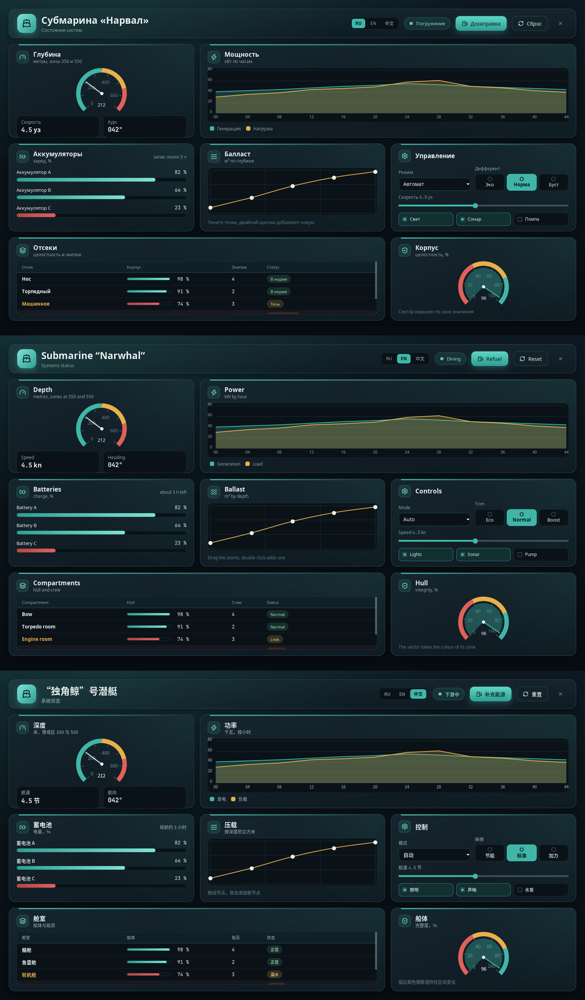

# BaroUI

**HTML/CSS UI framework for Barotrauma.** Write a window as an ordinary `.html` page with a `.css` sheet and drive it from a C# class; BaroUI lays it out and draws it with the game's own sprite batch. There is no browser inside the game: BaroUI is its own layout and paint engine written for the game loop (no allocations in a steady frame, restyles limited to what changed).



*The example mod in `examples/BaroUI_Example` in its three languages (one at a time: RU / EN / 中文), rendered by the engine's painter outside the game.*

Version **0.3.0**. On the Steam Workshop: [BaroUI — HTML/CSS UI framework](https://steamcommunity.com/sharedfiles/filedetails/?id=3840968580). Namespace `BaroUI`, package **Baro-UI**. It grew inside the modpack *Barotrauma: Beyond the Europa*, where more than a dozen packages use it for their windows.

## What it can do

- **Layout:** block, inline, flex, grid, relative/absolute positioning, `position: sticky`, scrolling, `line-clamp`, word wrap with Russian typography rules.
- **Styling:** cascade with specificity and variables; `:hover`, `:active`, `:focus`, `:focus-within`, `:not()`, `:has()`, `+`, `~`, `::before` / `::after`; per-corner radii, `box-shadow` with blur, `linear-gradient` (any angle), `radial-gradient`, several background layers, `outline`, `text-shadow`, `text-decoration`, background images, `` with its natural size, 9-slice `border-image`, game sprites. Edges of corners, rings and circles are anti-aliased analytically; `overflow: hidden|auto` with `border-radius` clips the children to the rounded shape.
- **Text and icons:** JetBrains Mono, PT Serif, Caveat, Noto Sans and Noto Sans SC for Chinese (both from the game folder); **your mod's own fonts** with `@font-face` (the file lives in your package) or `BaroUi.RegisterFont`; icons by name from Lucide (`<i data-icon="trash-2">`, `content: icon("…")`).
- **Animation:** transitions (including `box-shadow` and colours) and `@keyframes`.
- **Media:** `<video>` with WebM through the game's own decoder (autoplay, loop, muted, poster; decoding only while visible).
- **Charts:** `<chart>` (line, area, bar, step, axes, hover tooltip), editable `<curve>` (drag points; the same curve is evaluated by `PointCurve` in game code), `<gauge>` (dial with zones), and a drawing kit for your own `<canvas>`.
- **Input:** buttons, text fields, text areas, number fields (wheel), checkboxes, radio groups, sliders, selects, a code editor with highlighting (XML, Lua, C#), focus and `tabindex`, key bindings (`data-keys`), popups and context menus, drag and drop between blocks, mouse buttons 4/5 and Alt+arrows as back/forward, files dropped onto a window, game inventory cells (`<slot>`, with or without the game's frame).
- **Data binding:** `{{path}}` with .NET formats, `data-for` lists (virtual from 100 rows), `data-if`, `data-class`, two-way `data-model`, translations through the game's texts (`data-t`), handlers by name (`[UiHandler]`).
- **Tools:** live reload (`baroui watch`), an overlay of layout boxes and problems (`baroui debug`), `baroui problems`, `baroui version`.

What it does **not** do (yet), with the reasons, is listed in the reference, section 11.

## Requirements

- Barotrauma 1.13.x with [LuaCsForBarotrauma](https://github.com/evilfactory/LuaCsForBarotrauma) and C# mods enabled in its settings.
- Stock LuaCs runs C# mods in the lobby, in rounds and in the editors. Windows in the **main menu** need a LuaCs that keeps mods running there (the BBE modpack ships such a fork).

## Install

Subscribe on the [Workshop](https://steamcommunity.com/sharedfiles/filedetails/?id=3840968580), or put this repository (or the `BaroUI-x.y.z.zip` of a release) into the game's `LocalMods` folder, e.g. `LocalMods/BaroUI`, and enable **Baro-UI** above the mods that use it. On the Workshop, a mod that uses BaroUI lists it as a required item.

## Use it from your mod

Your mod is a LuaCs C# package loaded after Baro-UI; its code sees the engine's types directly.

```csharp
using BaroUI;

public sealed class FuelView : BaroUiView
{
    protected override void OnOpen() => Data = new { level = 40, rods = new[] { new { id = 1, name = "Rod" } } };
    [UiHandler] private void refill(int id) { /* ask the server; its answer updates Data */ }
}

// at start: refuse to run on an older engine, with one clear line in the log
if (!BaroUi.Requires("0.3.0", "My mod")) return;
BaroUi.Open<FuelView>(Path.Combine(myPackageDir, "UI", "fuel.html"));
```

```html
<div class="panel">
  <h1>Fuel: {{level}}%</h1>
  <div data-for="r in rods" data-key="r.id" class="row">
    <span>{{r.name}}</span>
    <button onclick="refill(r.id)">Refill</button>
  </div>
</div>
```

A complete template mod is in [`examples/BaroUI_Example`](examples/BaroUI_Example) (console command `baroui_example`); its README explains how to turn it into your own mod.

## Documentation

- Reference — every feature, nuance and limit, each fact marked by how it was checked: [English](docs/REFERENCE.en.md) · [Русский](docs/REFERENCE.ru.md) (source of truth) · [简体中文](docs/REFERENCE.zh-CN.md)
- Public API and versioning rules: [docs/API.md](docs/API.md)
- Authoring guide (Russian): [docs/AUTHORING.md](docs/AUTHORING.md) · performance notes (Russian): [docs/PERF.md](docs/PERF.md)

The documents were written in the modpack repository: a path `own/BBE_UI/…` in them is the root of this repository, `own/BaroUI_Example` is `examples/BaroUI_Example`; the test tools they mention (`tools/ui_test`, `tools/ui_host`) are not part of this release.

## Status

0.3.0 is tested by about 9 000 automated checks of the engine core and by the engine's painter outside the game. Several features are **not verified in the game yet** (video sound and looping, mouse buttons 4/5, the example mod, charts in a live window, gauges, slot frames, mod fonts, rounded clipping); the reference marks each of them.

## Console

| Command | What it does |
|---|---|
| `baroui open <page>` / `close [page]` / `list` | opens `UI/<page>.html` (with `UI/<page>.data.json` as sample data), closes it, lists the windows |
| `baroui reload [page]` | reloads HTML and CSS in place (data, C# class and scroll stay) |
| `baroui watch` | reloads a window when its files change |
| `baroui debug` | layout boxes and the problems of a page |
| `baroui problems [page]` | what the engine skipped (unknown properties, bad values) |
| `baroui version` | the engine version |

The old name `bbe_ui` of the command still works.

## License

MIT, see [LICENSE](LICENSE). The bundled fonts and the sample video keep their own terms: [THIRD_PARTY_NOTICES.md](THIRD_PARTY_NOTICES.md).
